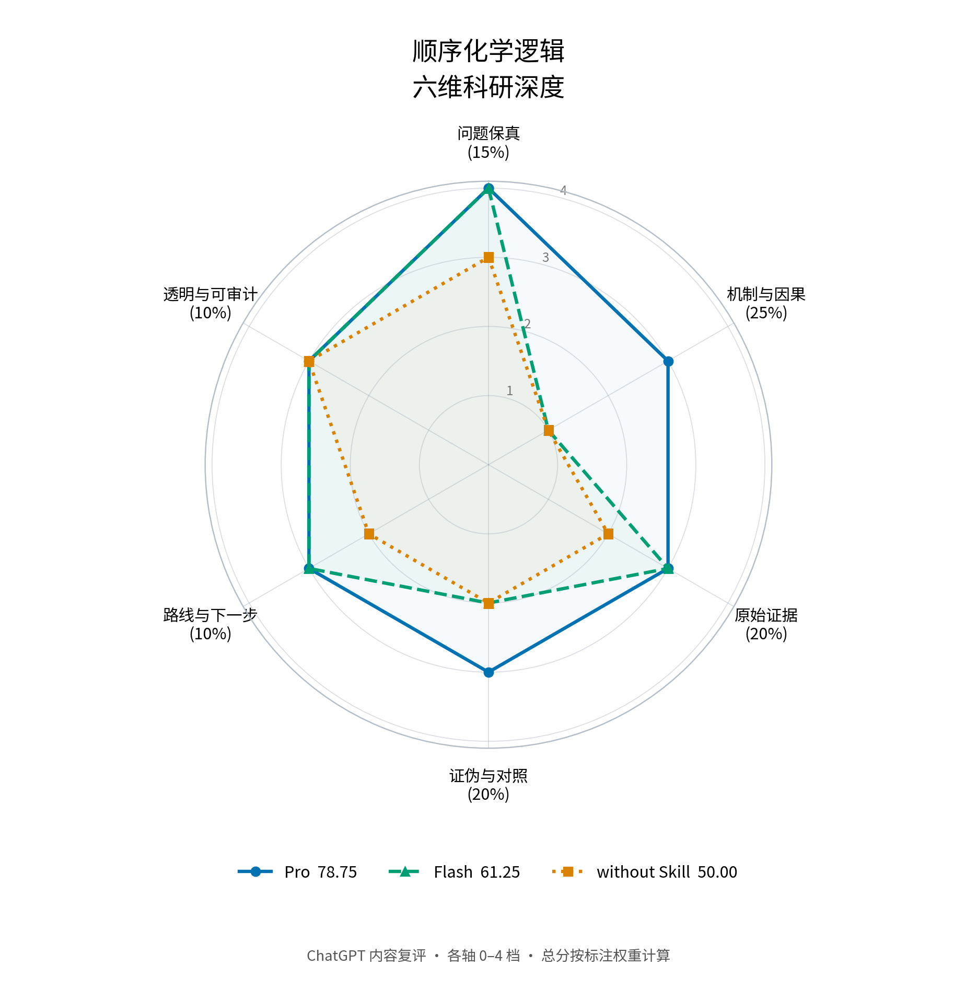

# 你来好奇，师弟跑腿：Shidi 怎样接住一句科研灵感

2026 年 8 月的一个工作日，我脑海里突然出现了一串流程图。它把我多年用 AI 搜文献、找思路时积累的痛点接了起来：解释背景、拆解角度、追索原文、核对证据，再把零散回答整理成可以继续研究的问题。我借助 Claude Code 和 Mermaid，把这串流程图做成了 shidi-skill。

刚做出来时，我没想那么多。它对我好用，也省下了很多精力。用了两个月，它有时笨笨的，有时又挺聪明：会回头问我问题，也会带着文献和新的线索回来，很像一个真正的师弟。

国庆之后，OpenAI 公布的七百余篇数学研究手稿，让我又开始思考科研的意义。工具越来越擅长解题，我更在意自己想问什么。一个问题为什么值得惦记，往往和人的经历、困惑与好奇心有关。[来源与完整创作手记](AUTHOR_STORY.md)

我喜欢“愚公移山”这个比喻：AI 可以帮我搬石头，哪座山值得移、为什么坚持，仍和我自己的选择有关。Shidi 的灵感和开发，也是我七年科研经历留下的一点创造力。

**Shidi 想接住的是这个起点：用户只有一句“能不能……”，先沿着原文做有边界的探索，再一起把问题长出来。**

## 一次安装，选择两种工作方式

- **Pro**：适合详细拆解、原文核验、候选比较与交叉检查；默认使用。
- **Flash**：适合少确认、快速启动，先形成小范围探索方案。

两者是同一个 Skill 的两套流程，可以接在宿主支持的模型上。本次案例的 Pro 固定为 `b28eb4e`，Flash 固定为 `6e03d72`。

## 从兴趣起点到研究问题，流程怎样工作

1. **保留原始问题**：先辨认用户真正想实现的现象，再确定值得查的少数机制。
2. **分路检索**：用相关领域的不同术语寻找候选，不只追逐与原句最相似的标题。
3. **获取与核验原文**：记录 DOI、阅读深度和 PDF 获取结果；下载成功再核对文件与论文对应关系。
4. **比较证据的适用范围**：分别判断论文证明了组件、组合，还是目标现象；核对输入顺序、环境和指标。
5. **找出缺的一环**：列出让候选机制成立所需的状态保持、动力学或逆序对照。
6. **形成可验证问题**：交付候选比较、最小实验、文献清单和可复核文件。

关键是第 4、5 步：有相似论文，未必已经有足以回答原问题的证据。下面两个实际案例展示这一步的作用。

## 案例一：材料能否只在“先光照、后遇湿”时打开？

这里需要的机制是“光照产生一个能保持的中间状态，后续遇湿才打开”。所以既要检查正序，也要检查仅光、仅湿和逆序。

对照组找到了一篇 UV 响应纳米海绵论文，但水下预浸后再照光的应用场景，并不能证明“先湿后光不打开”。Flash 的光生酸路线也需要回答同一个问题：如果水已经存在，后来生成的酸仍可能触发反应。

**Pro 识别了这个逆序风险，把问题收敛为：怎样保存第一次输入的状态，同时让反向输入路径失效？** 这使调研从寻找双响应材料，前进到需要实验验证的顺序判据。

原文线索：[UV 响应纳米海绵](https://doi.org/10.1038/srep12908)；[分子键盘锁综述](https://doi.org/10.1039/C7CS00287D)。解读与原始输出可在本案例目录逐项核对。

| 条件 | ChatGPT 六维内容复评 |
|---|---:|
| Pro | 78.75 |
| Flash | 61.25 |
| without | 50.00 |



这一案例中，Pro 的帮助集中在机制与因果判断：它把“找到相似响应材料”推进到“哪一个顺序对照还缺证据”。

## 案例二：涂层能否像打疫苗一样，第一次受伤后第二次修复更快？

这个想法连接了损伤响应、自修复和状态记忆。首先要辨认三个不同命题：“损伤后变强”“能多次修复”和“第二次比第一次修得更快”。

**Pro 将完整目标与文献中的机制组件分开**，提出潜伏活性种和机械自由基两条候选路线，并把尚需验证的环节明确为：首次损伤留下什么状态、状态能保留多久、它是否真的改变第二次修复动力学。

因此下一步有了具体做法：比较两次相同损伤的修复曲线，加入无预损伤、等修复剂可得性及状态衰减对照，区分局部闭合和材料性能恢复。在本次检索范围内，完整的“首次损伤记忆→第二次加速”仍作为待验证问题保留。

原文线索：[聚合物机械化学工具](https://doi.org/10.1039/d0cs00940g)；[载荷触发级联强化](https://doi.org/10.1002/anie.202010043)；[活性种持久性研究](https://doi.org/10.1021/om300161z)。这些来源用于核查机制组件，完整二次加速需要另行实验验证。

这个案例重点展示问题如何形成：Pro 从“像打疫苗”这个类比，走到状态产生、保持与第二次修复动力学三个可分别核查的环节，为继续追问提供了入口。

第二案例的完整三组输出、六维图与分项见[独立复评目录](https://github.com/IcyCreamDAS/shidi-skill/blob/competition/sanitized-2026-10-27/examples/pro-flash-evaluation/independent-review/README.md)。

## 这两个案例展示了什么

第一题展示 Pro 对机制断点的判断；第四题展示 Skill 怎样帮助形成可验证的问题。两者共同指向**保留想法、核查证据、推进追问**。这也解释了它适合怎样的用户：还不会系统拆解课题，但愿意从一个新奇兴趣点出发，沿着真实文献逐步形成自己的问题。

使用时，需要细致拆解和证据核验可选 Pro；希望尽快得到一版小范围探索可选 Flash。

## 安装与调用

Pro/Flash 已通过 PR 发布到默认 `main` 分支，直接安装即可：

```bash
git clone https://github.com/IcyCreamDAS/shidi-skill.git
mkdir -p ~/.claude/skills
cp -r shidi-skill/skills/shidi ~/.claude/skills/
```

```text
师弟，帮我详细调研一下 XXX              # Pro
师弟，请你用 pro 模式给我调研一下 XXX   # Pro
师弟，帮我快速调研一下 XXX              # Flash
师弟，请你用 flash 模式给我调研一下 XXX # Flash
```

不指定模式时默认 Pro。其他宿主使用其支持的 Skill 安装目录。

## 模型与预算怎么选

Pro 会展开较多检索、核验和交互；没有约定范围与停止条件时，token 消耗可能增长很快。我建议先从低成本模型开始，把文献上限、补检轮次与首轮交付物说清楚，再按关键证据的难度增加投入。

这两个案例实际使用的是 K2.8 Preview + max，完成了检索、原文获取、证据比较与问题拆解。Pro/Flash 是流程名称，可以搭配宿主支持的模型。

## 材料与评分方法

[完整实例与复现步骤](https://github.com/IcyCreamDAS/shidi-skill/blob/competition/sanitized-2026-10-27/examples/pro-flash-evaluation/README.md)保留两案例各三组的输入、报告、文献、获取记录、用量和可见工具轨迹。

本次执行模型统一为 K2.8 Preview + max，各组从独立会话开始，使用同一初始问题、共同任务要求和工具预算；实际问答与投入按原记录保留。本文主展示为 ChatGPT 对现有输出的六维内容复评，权重为15/25/20/20/10/10，各轴0–4档。评分者已知条件名，为事后非盲评阅。评分数据、量表、源文件哈希和绘图代码见独立复评目录；此前 Kimi 评分保留在历史表中另列。结果对应这里展示的两次案例运行，时间、token与交互另表呈现。
