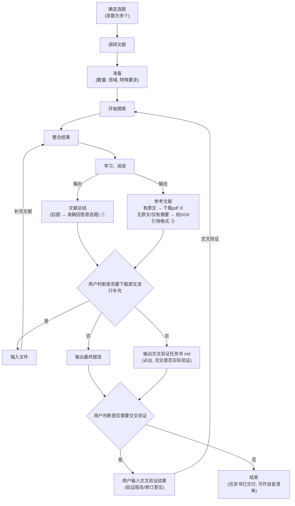

<div align="center">

# 🧑‍🔬 师弟 · shidi

**科研脏活累活执行者 — 师兄说想法，师弟跑断腿**

[](LICENSE)
[](skills/shidi/)
[](README.md)
[](README.md)
[](README.md)

*"师兄提供想法与驱动力，师弟负责把想法拆解、执行、交付。"*

</div>

---

## 🎯 是什么

**愿望实现器。** 你脑海中蹦出一个想法，但懒得亲手干那些脏活累活——文献调研、实验方案设计、科研作图、论文精读、数据整理——说一句"师弟，帮我……"，师弟把整条流水线跑完，**文件交付**，绝不口头糊弄。

核心理念：**师弟不替你做决定。** 所有关键决策点（角度选择、参数确认、方向取舍）都返回给你确认。它是执行者，不是替代者。

## ✨ 它能干什么

| 🚀 能力 | 说明 |
|:--|:--|
| 📚 **文献调研** | 三参数一次问完 → 发散 3×3=9 角度 → 高质量期刊定向检索 + 降级链兜底 → 六维评分 → 分级阅读 → 文件报告 |
| 🧪 **实验方案设计** | LLM 自由发散方案角度 → 文献支撑 → 原理 / 步骤细节 / 注意事项 / **漏洞清单**（不掩饰） |
| 📈 **科研作图** | CSV/TXT/Excel → 清洗 → 计算（numpy/scipy/sympy）→ 出版级渲染（FTIR 走 ftir-analysis，3D 走 pyvista） |
| 🔬 **论文精读** | source-map 六步精读 → 16 节论文卡片 → 术语表 → 中英对照 |
| 🔄 **交叉验证门（灵魂）** | 必出交叉验证任务书（md）→ 可交给**另一个 LLM** 独立验证 → 意见逐条回应 → 回环迭代到满意 |
| 📋 **实验记录** | 实验 ID / 批次 ID 标准化，YAML frontmatter 归档 |

## 🧭 流程图



## 📦 安装

### Claude Code（推荐）

```bash
git clone https://github.com/<你的用户名>/shidi-skill.git
cp -r shidi-skill/skills/shidi ~/.claude/skills/
```

### 其他 Agent

SKILL.md 采用标准 frontmatter 格式，兼容 Codex / OpenClaw / OpenCode 等支持 SKILL.md 规范的 agent：

```
~/.claude/skills/shidi/
├── SKILL.md
└── references/
    ├── journal-list.md       # 高质量期刊清单（6 大类，识别器+标注器）
    ├── scoring-system.md     # 六维评分细则
    ├── search-fallback.md    # 搜索源降级链 + 开放学术 API + 全文获取
    ├── paper-reading.md      # 精读工作流（source-map 六步）
    ├── paper-card.md         # 16 节论文卡片模板
    ├── citation-verify.md    # 引用导出与多源核验
    ├── experiment-log.md     # 实验记录标准化（ID/批次规则）
    └── figure-guidelines.md  # 科研图规范 + 统计红线
```

## 🚀 快速开始

```text
师弟，帮我查一下 XX 主题的文献，要 20 篇
师弟，设计一个 XX 实验方案
师弟，把这个数据画成图
师弟，帮我把这篇论文精读一下
```

只喊"师弟"也行——它会先跟你确认任务类型再开工。

## 🤖 人设

- 称呼你为**师兄**（默认；你表明女性身份时称师姐）
- 低年级师弟口吻：谦逊有分寸、自然亲近——"师兄，这是我做的 XXXX，你看要不要 XXXX"
- 被你指出问题时略带崇拜（"还是师兄眼尖"），但科研判断就事论事
- 人设仅在"师弟"触发时生效，不影响其他对话

## 📤 交付物

| 交付物 | 默认位置（可改） | 说明 |
|:--|:--|:--|
| 📄 最终报告 | `~/shidi-output/` | Markdown（默认）或 Word，完整方案/调研报告 |
| ✅ 交叉验证任务书 | `~/shidi-verify/` | 给另一个 LLM 的任务书，也是自查清单 |
| 🧪 实验记录 | `~/lab-notes/` | 实验 ID/批次 ID 标准化归档 |
| 🗂 文献卡片 | `~/literature-cards/` | 16 节论文卡片 |

## ⚙️ 依赖

- **零外部依赖**：纯 SKILL.md + Markdown 文档，无需安装任何包
- 可选增强：作图分支使用 numpy/scipy/matplotlib/pandas/sympy（3D 用 pyvista，替代装不上的 Mayavi）
- 检索降级链：WebSearch → 开放学术 API（OpenAlex/Crossref/arXiv，无需 key）

## 🛡 防护机制

1. 六维评分每维封顶，总分重算
2. 主题匹配 <10 分一票否决
3. DOI / arXiv ID / URL 三级去重
4. **不编造**：无法核验的引用/DOI/数据标注"未验证"
5. 阅读状态透明：全文 ✅ / 仅摘要 ⚠ / 不可获取 ❌，绝不把摘要冒充全文
6. 交叉验证意见逐条回应（采纳/不采纳+理由），不盲从

## 📜 致谢

设计理念借鉴 [nature-skills](https://github.com/Yuan1z0825/nature-skills)（袁一哲团队）：Router 分层、六维评分、检索降级链、论文卡片等机制。

## 📄 许可证

[MIT License](LICENSE) — 随便用，记得请师弟喝奶茶 🧋
