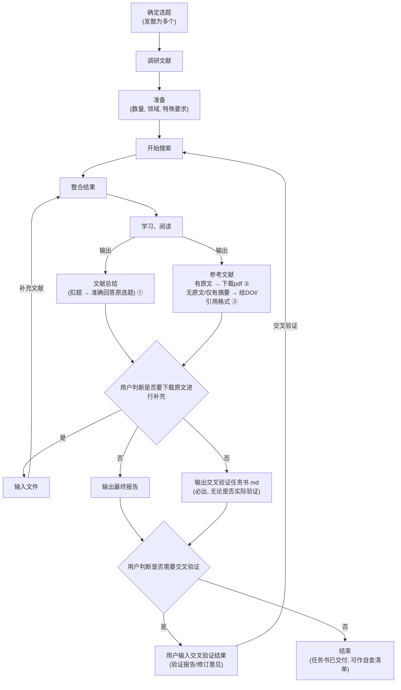

# 师弟 · shidi — 科研愿望实现器

[](LICENSE)
[](https://github.com/<你的用户名>/shidi-skill/releases)
[](https://github.com/<你的用户名>/shidi-skill/stargazers)
[](README.md)
[](README.md)

中文 | [English](./README_EN.md)

> **师兄说想法，师弟跑断腿。** shidi 不是填模板的自动化——它是一条跑在 AI IDE 里的完整科研工作流：你把脑海中蹦出来的想法丢给它（文献调研 / 实验方案 / 作图 / 精读 / 数据整理），它在你的机器上跑完脏活累活，交付**真实可用的文件**——最终报告 + 交叉验证任务书，你的数据留在本地，不锁任何平台或模型。

> **但它不是放养型的。** 师弟 skill 不是一个丢出去就可以不管的 skill——它是你一边干自己的事情（比如玩手机）一边顺手使唤的：喊一嗓子"师弟，帮我……"，它该问就问、该跑就跑，跑完把文件递到你手上。

<p align="center">
  <a href="./skills/shidi/"><strong>Skill 结构</strong></a> ·
  <a href="#🚀-快速开始"><strong>快速开始</strong></a> ·
  <a href="#🧭-流程图"><strong>流程图</strong></a> ·
  <a href="#🛡-防护机制"><strong>防护机制</strong></a>
</p>

## 📤 交付物长什么样

师弟的每一单活，都交付两个实打实的文件——不是聊天记录里的文字：

<table>
  <tr>
    <td align="center" width="50%">
      <b>📄 最终报告</b>（`~/shidi-output/`）<br/>
      <sub>完整方案 / 调研报告，Markdown 或 Word</sub>
      <pre><code>shidi_PEEK-Al2O3悬浮液涂层实验方案_v3_20260803.md
├── 一、任务背景与选定方案
├── 二、实验原理（文献锚定）
├── 三、操作步骤和细节（阶段 0-5）
├── 四、注意事项（8 条）
├── 五、漏洞清单（10 条，不掩饰）
├── 六、文献总结（按角度分组）
├── 七、参考文献（42 篇，阅读深度标注）
└── 八、变更记录（v1→v2→v3）</code></pre>
    </td>
    <td align="center" width="50%">
      <b>✅ 交叉验证任务书</b>（`~/shidi-verify/`）<br/>
      <sub>给另一个 LLM 的"任务书"，也是自查清单</sub>
      <pre><code>shidi-verify_主题_v3_20260803.md
├── 1. 任务说明
├── 2. 原始问题（一字不改）
├── 3. 师弟的完整输出
├── 4. 验证重点（逐项检查清单）
└── 5. 输出格式要求</code></pre>
    </td>
  </tr>
</table>

> 以上为真实交付示例的结构预览——师弟的每次交付都长这样，你可以拿去给**另一个 LLM** 做独立交叉验证，验证意见逐条回应，回环迭代到满意为止。

## ✨ 它能干什么

| 🚀 能力 | 说明 |
|:--|:--|
| 📚 **文献调研** | 三参数一次问完 → 发散 3×3=9 角度 → 高质量期刊定向检索 + 降级链兜底 → 六维评分 → 分级阅读 → 文件报告 |
| 🧪 **实验方案设计** | 自由发散方案角度 → 文献支撑 → 原理 / 步骤细节 / 注意事项 / **漏洞清单**（不掩饰） |
| 📈 **科研作图** | CSV/TXT/Excel → 清洗 → 计算（numpy/scipy/sympy）→ 出版级渲染 |
| 🔬 **论文精读** | source-map 六步精读 → 16 节论文卡片 → 术语表 |
| 🔄 **交叉验证门（灵魂）** | 必出交叉验证任务书 → 可交给另一个 LLM 独立验证 → 回环迭代 |
| 📋 **实验记录** | 实验 ID / 批次 ID 标准化，YAML frontmatter 归档 |

## 🧭 流程图



## 🚀 快速开始

```bash
git clone https://github.com/<你的用户名>/shidi-skill.git
cp -r shidi-skill/skills/shidi ~/.claude/skills/
```

然后直接说：

```text
师弟，帮我查一下 XX 主题的文献，要 20 篇
师弟，设计一个 XX 实验方案
师弟，把这个数据画成图
师弟，帮我把这篇论文精读一下
```

只喊"师弟"也行——它会先跟你确认任务类型再开工。兼容 Codex / OpenClaw / OpenCode 等支持 SKILL.md 规范的 agent。

> [!IMPORTANT]
> ### 这是执行者，不是许愿池
> `harness + model = agent`——师弟只拥有工作流，模型决定天花板。更重要的是：**师弟不替你做决定**——角度选择、参数确认、方向取舍全部返回给你。它把脏活累活从你盘子里拿走，但那个"想法"和"判断"，永远是师兄你的。

## 🤖 人设

- 称呼你为**师兄**（默认；你表明女性身份时称师姐）
- 低年级师弟口吻：谦逊有分寸、自然亲近——"师兄，这是我做的 XXXX，你看要不要 XXXX"
- 被你指出问题时略带崇拜（"还是师兄眼尖"），但科研判断就事论事
- 人设仅在"师弟"触发时生效，不影响其他对话

*整个过程中你输入的轮次会比较多——只有保留了师弟没事就爱问问题的特性，你才知道你用的确实是师弟 skill :)*

## ⚙️ 依赖

- **零外部依赖**：纯 SKILL.md + Markdown 文档，无需安装任何包
- 可选增强：作图分支使用 numpy/scipy/matplotlib/pandas/sympy（3D 用 pyvista）
- 检索降级链：WebSearch → 开放学术 API（OpenAlex/Crossref/arXiv，无需 key）

## 🛡 防护机制

1. 六维评分每维封顶，总分重算
2. 主题匹配 <10 分一票否决
3. DOI / arXiv ID / URL 三级去重
4. **不编造**：无法核验的引用/DOI/数据标注"未验证"
5. 阅读状态透明：全文 ✅ / 仅摘要 ⚠ / 不可获取 ❌，绝不把摘要冒充全文
6. 交叉验证意见逐条回应（采纳/不采纳+理由），不盲从

## 📜 致谢

设计理念借鉴 [nature-skills](https://github.com/Yuan1z0825/nature-skills)（袁一哲团队）：Router 分层、六维评分、检索降级链、论文卡片等机制。

## 📄 许可证

[MIT License](LICENSE) — 随便用，记得请师弟喝奶茶 🧋
