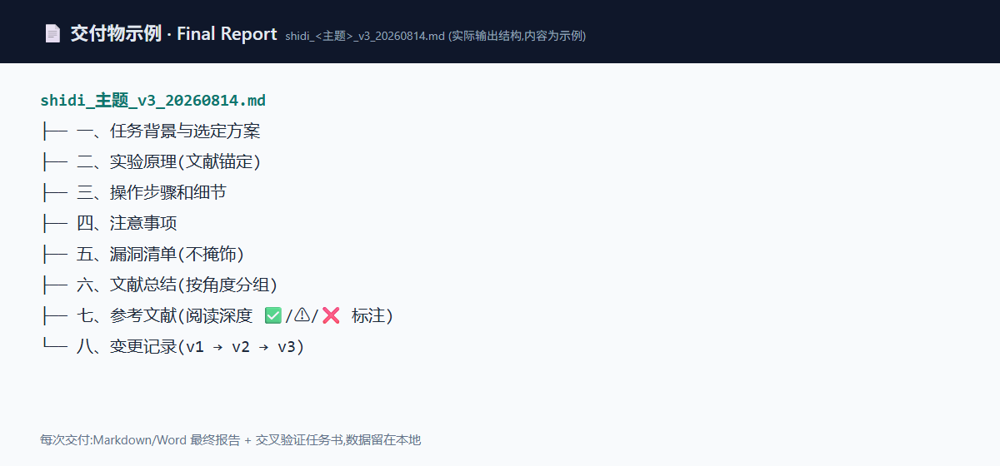
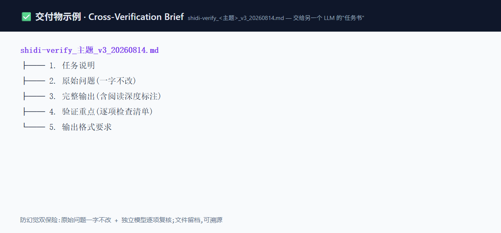
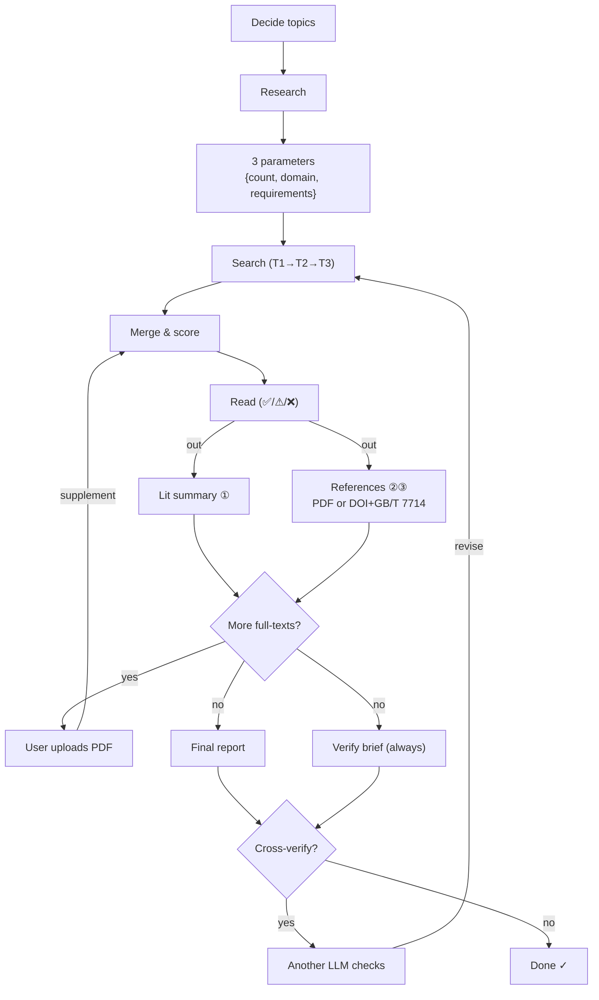

# shidi · 师弟 — Your Junior Lab Mate in an Agent Skill 🧑‍🔬
*Research workflow skill for AI coding agents: literature review · experiment design · scientific figures · paper reading · data organization*
### *You bring the ideas, shidi does the legwork.*

[](LICENSE)
[](https://github.com/IcyCreamDAS/shidi-skill/releases)
[](https://github.com/IcyCreamDAS/shidi-skill/stargazers)
[](README.md)
[](README.md)
[](https://github.com/IcyCreamDAS/shidi-skill/pulls)

[中文](./README.md) | English

**Start with an interest, identify gaps in cross-field evidence, and form a testable research question.** Shidi organizes search, source retrieval, candidate comparison and validation plans into reusable files.

> shidi (*"junior lab mate"* in Chinese) is a complete research workflow that lives inside your AI IDE — not a prompt template. Hand it an idea (literature research / experiment design / figures / paper reading / data chores), and it returns **real deliverable files**. Deliverables are saved in your working directory. No platform or model lock-in.
>
> It's not fire-and-forget, either — shidi is meant to be bossed around while you do something else. Say "shidi, help me with …", and it asks when it must, runs the rest, and hands you the files.

> **Built for AI for Science workflows, grad students and researchers using agentic AI** — literature review, experiment design, figures and paper reading become deliverable, cross-verifiable files instead of chat answers.

<p align="center">
  <a href="#-whats-new"><strong>What's New</strong></a> ·
  <a href="#-deliverables"><strong>Deliverables</strong></a> ·
  <a href="#-why-shidi"><strong>Why shidi</strong></a> ·
  <a href="#-quick-start"><strong>Quick Start</strong></a> ·
  <a href="#-demo"><strong>Demo</strong></a> ·
  <a href="#-guardrails"><strong>Guardrails</strong></a> ·
  <a href="#ai4s-evidence"><strong>AI4S</strong></a>
</p>

---

## 👀 Demo

> Screenshots below are **illustrative** (content redacted) — real runs produce fresh files for your own topic.

<p align="center">
  
  
</p>

---

## ✨ What's New

- **2026-10-27: Pro / Flash modes** — One installation includes both workflows. Pro is the default; request “quick research” or “flash mode” for Flash. Released to the default `main` branch through a pull request.
- **2026-10** — 🛡 **Release self-check loop**: GitHub Actions CI + `validate.py` (version, links, script compilation, required files) + offline `tests/` · published `verify_refs.py` (DOI resolution, retraction detection, style lint) · fixed the `render_report.py` timeout bug and added cross-platform browser discovery · `fetch_pdfs.py` no longer hardcodes an email and now backs off on 429/5xx
- **2026-10** — 🔬 **Deterministic scoring + data schema + AI4S demo upgrade**: `score_papers.py` seven-dim scoring (caps, veto and ranking computed by script; v2 lowers journal/network weight) · literature → formulation/property extraction schema (test standard, conditions, n, error, three claim labels) · demo upgrade (mass closure, ARD length scales, ECI acquisition, 1-2 benchmark-run calibration, Pareto front, literature-prior bounds)
- **2026-08** — 📥 Batch PDF download (OpenAlex/Unpaywall OA lookup; failures classified and reported, never silently skipped)
- **2026-08** — 📄 Multi-format reports (Markdown → HTML → PDF via headless Edge printing, zero deps)
- **2026-08** — 🔍 PDF extraction layer (text-based → Markdown to save context; scans auto-tagged `needs_vision` for the vision route)
- **2026-08** — 🗂 Per-angle intermediate reports (parallel multi-agent research: one file per angle, merge by reading files only — main context never overflows)

## 📤 Deliverables

Every job ends in **real files** — not chat text.

<table>
  <tr>
    <td align="center" width="50%">
      <b>📄 Final Report</b>（`~/shidi-output/`）<br/>
      <sub>Markdown / Word · full report or experiment plan</sub>
      <pre><code>shidi_&lt;topic&gt;_v3_20260814.md
├── 1. Background & chosen approach
├── 2. Principle (literature-anchored)
├── 3. Steps & details
├── 4. Precautions
├── 5. Flaw list (unvarnished)
├── 6. Literature summary (by angle)
├── 7. References (reading depth ✅/⚠/❌)
└── 8. Changelog (v1→v2→v3)</code></pre>
    </td>
    <td align="center" width="50%">
      <b>✅ Cross-Verification Brief</b>（`~/shidi-verify/`）<br/>
      <sub>A task sheet for another LLM — also your self-check list</sub>
      <pre><code>shidi-verify_&lt;topic&gt;_v3_20260814.md
├── 1. Task description
├── 2. Original question (verbatim)
├── 3. Full output (with reading depth)
├── 4. Verification checklist
└── 5. Required output format</code></pre>
    </td>
  </tr>
</table>

> Every delivery looks like this. Take the brief to **another LLM** for independent verification — every comment gets an adopt/reject + reason, loop until you're satisfied.

## ✨ Why shidi

| Chatting with a raw model | shidi |
|:--|:--|
| Answers live in the chat log | Delivers **files**: reports, briefs, figures, CSVs — archivable, citable, shareable |
| You nudge it step by step | Built-in workflow (search → score → read → report → verify); answer 3 parameters and it runs |
| Hallucinations on your conscience | Seven-dim scoring (computed by script), DOI/retraction verification, DOI triple-dedup, no-fabrication rule, honest reading-depth labels, mandatory verification brief |
| Behavior changes with the model | Pure SKILL.md + Markdown — works in Claude Code / Codex / OpenClaw / any SKILL.md agent |

## 🚀 Capabilities

| Capability | Description |
|:--|:--|
| 📚 **Literature research** | 3 parameters up front → 3×3=9 angles → top-journal targeted search + fallback chain → seven-dim scoring (v2, script-checked) → graded reading → batch PDF download → file report |
| 🧪 **Experiment design** | Free-form approach brainstorm → literature-backed → principle / steps / precautions / **unvarnished flaw list** |
| 📈 **Figures** | CSV/TXT/Excel → clean → compute (numpy/scipy/sympy) → publication-grade rendering, with Origin-ready data export |
| 🔬 **Paper reading** | source-map six-step deep read → 16-section paper cards → glossary |
| 🔄 **Cross-verification (the soul)** | Always emits a verification brief → another LLM checks independently → iterate in loops |
| 📋 **Lab notes** | Standardized experiment/batch IDs, YAML frontmatter archiving |

<a id="ai4s-evidence"></a>
## 🧪 AI4S Evidence

[`examples/materials_small_data/`](examples/materials_small_data/) is a **synthetic-only**, small-data formulation → property demo that shows the claim discipline shidi uses for AI4S data work:

- **Grouped validation** (leave-one-project-out) — sibling samples from the same project never leak into training, so scores stay honest
- **GP predictions with uncertainty** — empirical coverage of ±1σ / ±2σ on held-out projects, compared with the 68% / 95% targets
- **Batch calibration test** — zero-shot vs adding 1–2 benchmark runs from the new project; coverage barely moves, and the negative result is reported instead of hidden
- **ARD feature relevance** — per-feature GP length scales (smaller = more influential; at the upper bound = the data cannot identify a dependence)
- **Constrained search with ECI** — `ECI = EI × P(MFR ≥ 28)` instead of a hard feasibility cutoff, plus a feasibility-only shortlist
- **Multi-objective Pareto front** — tensile strength vs MFR posterior means
- **Mass-fraction closure** — filler + additive_a + additive_b + matrix = 100 wt%; candidates keep `matrix ≥ 40 wt%`
- **Literature-prior interface** — `priors_template.csv` feeds survey bounds into the search space (bounds only, no prior mean)
- **Separated evidence labels** — `measured` / `predicted` / `exploratory`; only `measured` may be reported as a result
- **Hard rule: an exploration screening range is NOT a statistical confidence interval**

```bash
cd examples/materials_small_data
pip install -r requirements.txt && python run_demo.py
python run_demo.py --priors priors_template.csv   # constrain the search space with survey bounds
```

**What it does not claim:** the data is synthetic, so it predicts no property of any real material; the GP scores do not transfer to any real formulation dataset; the shortlist is not proven better than an experienced engineer's DOE intuition; independent single-output GPs ignore output correlation (tensile ↔ flexural ≈ 0.9); 1–2 benchmark runs do not calibrate a batch offset (that needs a mixed-effects GP). Real industrial formulations stay under NDA — what is published here is the **method**, not data.

## 🧭 Flow



## 🚀 Quick Start

```bash
git clone https://github.com/IcyCreamDAS/shidi-skill.git
mkdir -p ~/.claude/skills
cp -r shidi-skill/skills/shidi ~/.claude/skills/
```

Then just say:

```text
师弟，帮我详细调研一下 XXX              # Pro
师弟，请你用 pro 模式给我调研一下 XXX   # Pro
师弟，帮我快速调研一下 XXX              # Flash
师弟，请你用 flash 模式给我调研一下 XXX # Flash
```

**One download includes the complete Pro and Flash modes.** If the request does not specify “详细”, “快速”, “pro”, or “flash”, it defaults to **Pro**: structured searching, interactive clarification, and deep deliverables. Flash minimizes confirmation and starts quickly. Modes change the workflow and use the models supported by the host.

Other examples:

```text
shidi, design an experiment for XX
shidi, plot this data
shidi, read this paper in depth for me
```

Just "shidi" works too — it confirms the task type before starting. Compatible with any agent that follows the SKILL.md spec (Claude Code / Codex / OpenClaw / OpenCode…).

> [!IMPORTANT]
> ### An executor, not a genie
> `harness + model = agent` — shidi owns the workflow, the model sets the ceiling. Pro returns angle selection and parameter confirmation to you; Flash proposes defaults and reduces formal confirmation. It takes the grunt work; the ideas and judgment stay yours.

## 🤖 Persona

- Calls you "senior" (or "senior sister" if you say so)
- A humble, slightly cheeky junior: *"here's what I made, what do you think?"*
- Praises you when corrected ("good catch, senior"), never bends on science
- Persona activates only on the trigger word — other conversations unaffected

*Yes, it asks a lot of questions — that's how you know it's really shidi.*

## ⚙️ Dependencies

- **Zero core deps**: pure SKILL.md + Markdown, nothing to install
- Report rendering: `markdown` (HTML/PDF), plus a local Edge / Chrome / Chromium for PDF (auto-discovered cross-platform; override with `SHIDI_BROWSER`)
- Optional: numpy/scipy/matplotlib/pandas/sympy (figures; pyvista for 3D), pdf-inspector (PDF extraction layer)
- Scoring / citation scripts (`score_papers.py`, `verify_refs.py`): stdlib only
- Search fallback chain: WebSearch → open scholarly APIs (OpenAlex/Crossref/arXiv, no keys needed); the Unpaywall fallback in PDF download needs `UNPAYWALL_EMAIL`

## 🛡 Guardrails

1. Capped seven-dim scoring; totals and ranking computed by `score_papers.py`, never by the model
2. Topic-match <10 → veto
3. DOI / arXiv ID / URL triple dedup
4. **No fabrication** — unverifiable claims are labeled "unverified"; every report passes `verify_refs.py` (DOI resolution / retractions / style) before rendering
5. Honest reading-depth labels: full text ✅ / abstract ⚠ / unavailable ❌
6. Every verification comment gets adopt/reject + reason — never blind agreement

## 📜 Credits

Design ideas borrowed from [nature-skills](https://github.com/Yuan1z0825/nature-skills) (Yuan1z0825 team): routing, scoring dimensions (v1 six-dim → v2 seven-dim), search fallback chain, paper cards.

## 📄 License

[MIT License](LICENSE) — free to use; just buy shidi a bubble tea 🧋
