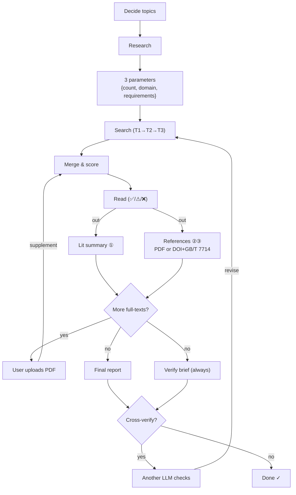

# shidi · 师弟 — Your Junior Lab Mate in an Agent Skill 🧑‍🔬
### *You bring the ideas, shidi does the legwork.*

[](LICENSE)
[](https://github.com/IcyCreamDAS/shidi-skill/releases)
[](https://github.com/IcyCreamDAS/shidi-skill/stargazers)
[](README.md)
[](README.md)
[](https://github.com/IcyCreamDAS/shidi-skill/pulls)

[中文](./README.md) | English

> shidi (*"junior lab mate"* in Chinese) is a complete research workflow that lives inside your AI IDE — not a prompt template. Hand it an idea (literature research / experiment design / figures / paper reading / data chores), and it returns **real deliverable files**. Your data stays local. No platform or model lock-in.
>
> It's not fire-and-forget, either — shidi is meant to be bossed around while you do something else. Say "shidi, help me with …", and it asks when it must, runs the rest, and hands you the files.

<p align="center">
  <a href="#-whats-new"><strong>What's New</strong></a> ·
  <a href="#-deliverables"><strong>Deliverables</strong></a> ·
  <a href="#-why-shidi"><strong>Why shidi</strong></a> ·
  <a href="#-quick-start"><strong>Quick Start</strong></a> ·
  <a href="#-guardrails"><strong>Guardrails</strong></a>
</p>

---

## ✨ What's New

- **2026-08** — 📥 Batch PDF download (OpenAlex/Unpaywall OA lookup; failures classified and reported, never silently skipped)
- **2026-08** — 📄 Multi-format reports (Markdown → HTML → PDF via headless Edge printing, zero deps)
- **2026-08** — 🔍 PDF extraction layer (text-based → Markdown to save context; scans auto-tagged `needs_vision` for the vision route)
- **2026-08** — 🗂 Per-angle intermediate reports (parallel multi-agent research: one file per angle, merge by reading files only — main context never overflows)

## 📤 Deliverables

Every job ends in **real files** — not chat text.

<table>
  <tr>
    <td align="center" width="50%">
      <b>📄 Final Report</b>（`~/shidi-output/`）<br/>
      <sub>Markdown / Word · full report or experiment plan</sub>
      <pre><code>shidi_&lt;topic&gt;_v3_20260814.md
├── 1. Background & chosen approach
├── 2. Principle (literature-anchored)
├── 3. Steps & details
├── 4. Precautions
├── 5. Flaw list (unvarnished)
├── 6. Literature summary (by angle)
├── 7. References (reading depth ✅/⚠/❌)
└── 8. Changelog (v1→v2→v3)</code></pre>
    </td>
    <td align="center" width="50%">
      <b>✅ Cross-Verification Brief</b>（`~/shidi-verify/`）<br/>
      <sub>A task sheet for another LLM — also your self-check list</sub>
      <pre><code>shidi-verify_&lt;topic&gt;_v3_20260814.md
├── 1. Task description
├── 2. Original question (verbatim)
├── 3. Full output (with reading depth)
├── 4. Verification checklist
└── 5. Required output format</code></pre>
    </td>
  </tr>
</table>

> Every delivery looks like this. Take the brief to **another LLM** for independent verification — every comment gets an adopt/reject + reason, loop until you're satisfied.

## ✨ Why shidi

| Chatting with a raw model | shidi |
|:--|:--|
| Answers live in the chat log | Delivers **files**: reports, briefs, figures, CSVs — archivable, citable, shareable |
| You nudge it step by step | Built-in workflow (search → score → read → report → verify); answer 3 parameters and it runs |
| Hallucinations on your conscience | Six-dim scoring, DOI triple-dedup, no-fabrication rule, honest reading-depth labels, mandatory verification brief |
| Behavior changes with the model | Pure SKILL.md + Markdown — works in Claude Code / Codex / OpenClaw / any SKILL.md agent |

## 🚀 Capabilities

| Capability | Description |
|:--|:--|
| 📚 **Literature research** | 3 parameters up front → 3×3=9 angles → top-journal targeted search + fallback chain → six-dim scoring → graded reading → batch PDF download → file report |
| 🧪 **Experiment design** | Free-form approach brainstorm → literature-backed → principle / steps / precautions / **unvarnished flaw list** |
| 📈 **Figures** | CSV/TXT/Excel → clean → compute (numpy/scipy/sympy) → publication-grade rendering, with Origin-ready data export |
| 🔬 **Paper reading** | source-map six-step deep read → 16-section paper cards → glossary |
| 🔄 **Cross-verification (the soul)** | Always emits a verification brief → another LLM checks independently → iterate in loops |
| 📋 **Lab notes** | Standardized experiment/batch IDs, YAML frontmatter archiving |

## 🧭 Flow



## 🚀 Quick Start

```bash
git clone https://github.com/IcyCreamDAS/shidi-skill.git
cp -r shidi-skill/skills/shidi ~/.claude/skills/
```

Then just say:

```text
shidi, research the literature on XX — 20 papers
shidi, design an experiment for XX
shidi, plot this data
shidi, read this paper in depth for me
```

Just "shidi" works too — it confirms the task type before starting. Compatible with any agent that follows the SKILL.md spec (Claude Code / Codex / OpenClaw / OpenCode…).

> [!IMPORTANT]
> ### An executor, not a genie
> `harness + model = agent` — shidi owns the workflow, the model sets the ceiling. And it never decides for you: angle selection, parameters, trade-offs all bounce back to you. It takes the grunt work; the ideas and judgment stay yours.

## 🤖 Persona

- Calls you "senior" (or "senior sister" if you say so)
- A humble, slightly cheeky junior: *"here's what I made, what do you think?"*
- Praises you when corrected ("good catch, senior"), never bends on science
- Persona activates only on the trigger word — other conversations unaffected

*Yes, it asks a lot of questions — that's how you know it's really shidi.*

## ⚙️ Dependencies

- **Zero external deps**: pure SKILL.md + Markdown, nothing to install
- Optional: numpy/scipy/matplotlib/pandas/sympy (figures; pyvista for 3D), pdf-inspector (PDF extraction layer)
- Search fallback chain: WebSearch → open scholarly APIs (OpenAlex/Crossref/arXiv, no keys needed)

## 🛡 Guardrails

1. Capped six-dim scoring, totals recomputed
2. Topic-match <10 → veto
3. DOI / arXiv ID / URL triple dedup
4. **No fabrication** — unverifiable claims are labeled "unverified"
5. Honest reading-depth labels: full text ✅ / abstract ⚠ / unavailable ❌
6. Every verification comment gets adopt/reject + reason — never blind agreement

## 📜 Credits

Design ideas borrowed from [nature-skills](https://github.com/Yuan1z0825/nature-skills) (Yuan1z0825 team): routing, six-dim scoring, search fallback chain, paper cards.

## 📄 License

[MIT License](LICENSE) — free to use; just buy shidi a bubble tea 🧋
