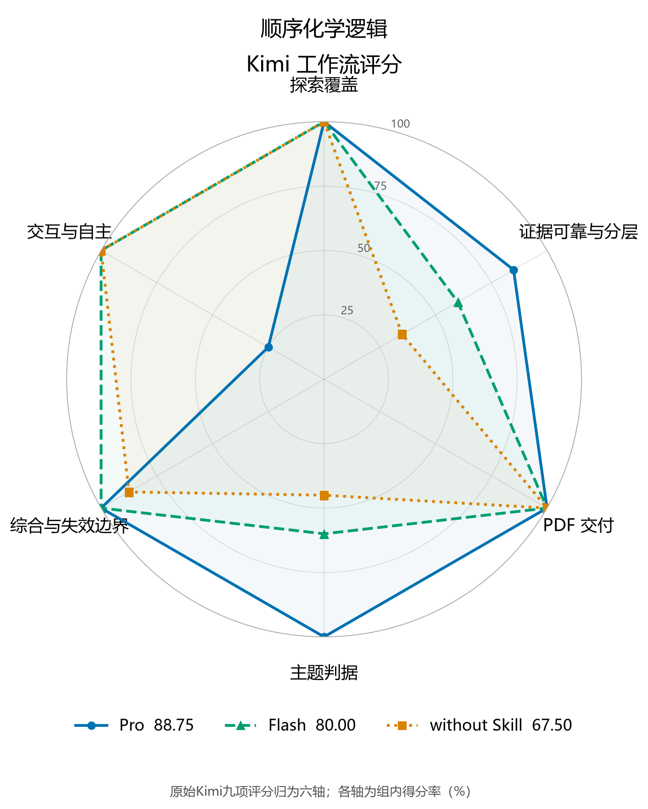
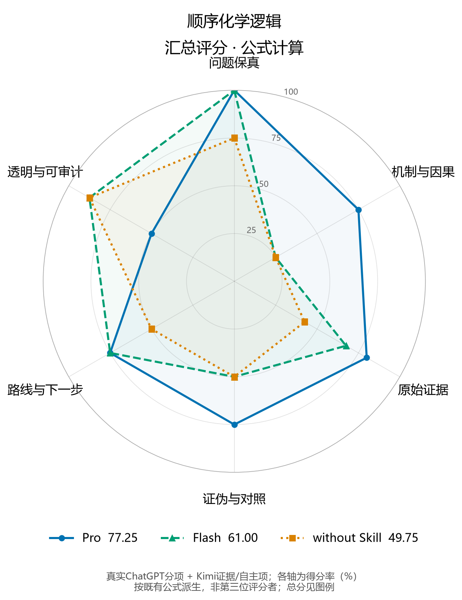
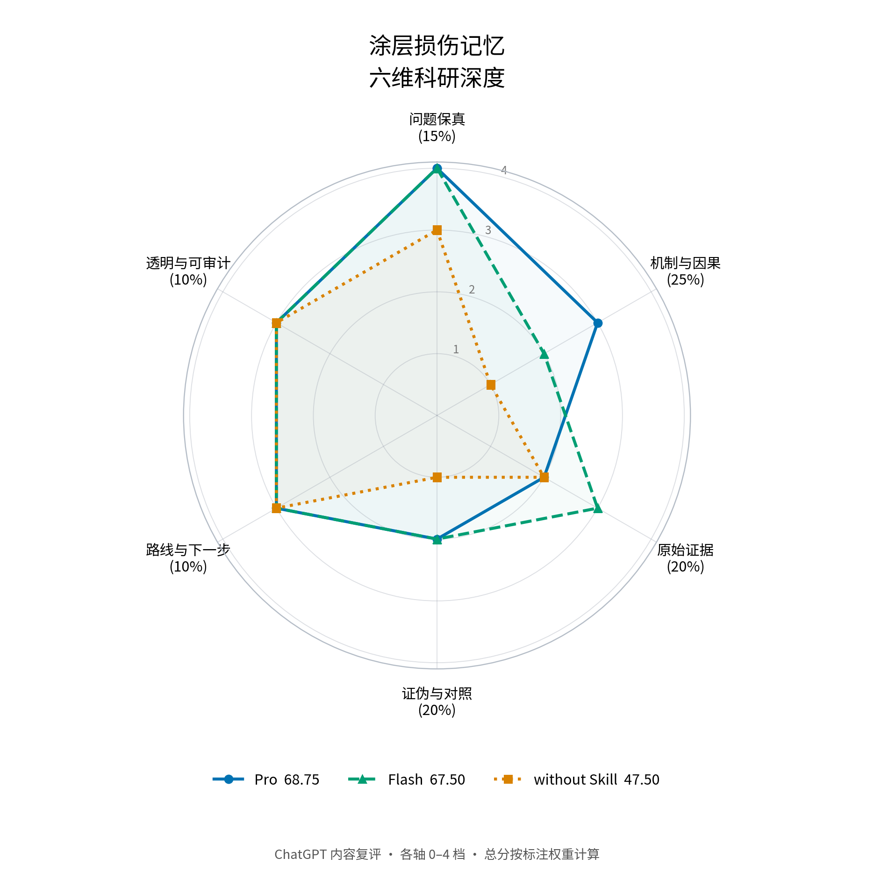
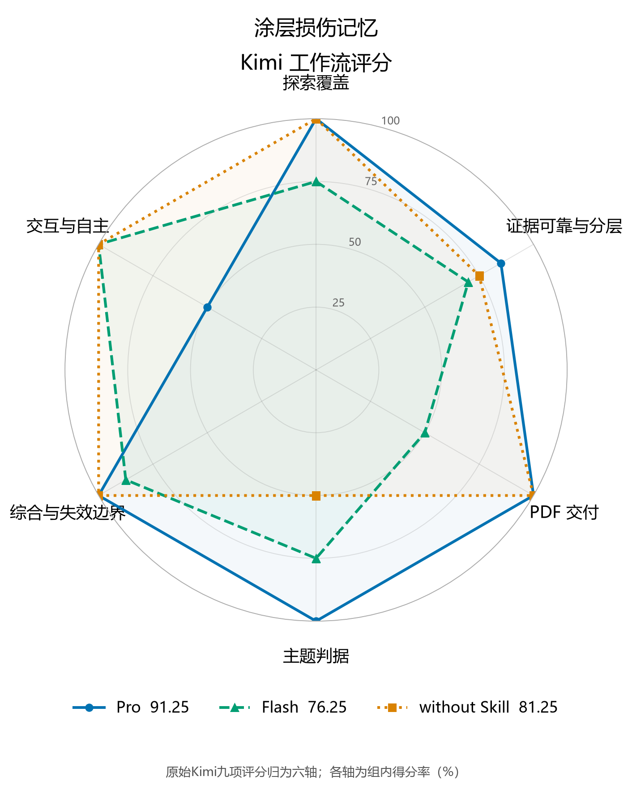
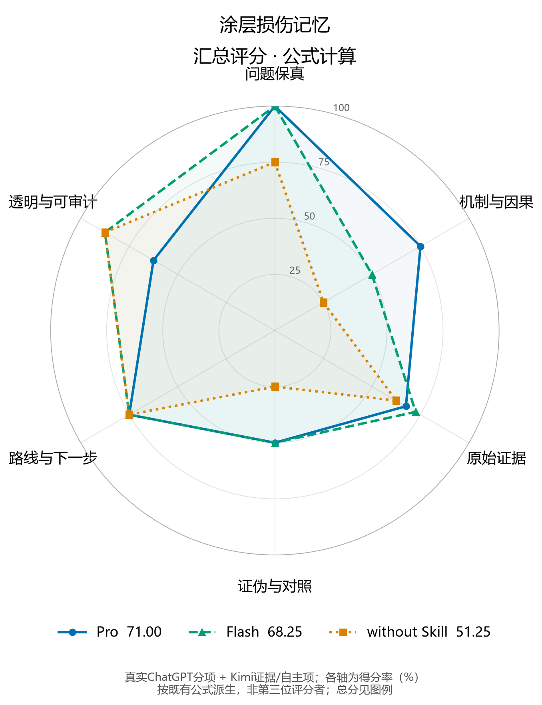

# Pro / Flash / without：每轮四张表、三张图

本页完整展示两轮真实运行：第一题顺序逻辑、第四题损伤记忆。每轮依次为ChatGPT评分细则、Kimi评分细则、最终评分、用量四张表，以及ChatGPT、Kimi、汇总三张六维图。表格均有MD/CSV，图均有PNG/SVG。

**ChatGPT分项由ChatGPT于2026-10-27直接复评既有输出**，源数据与报告哈希见[独立复评数据](independent-review/scores.json)，0–4档判据见[RUBRIC.md](independent-review/RUBRIC.md)。Kimi表沿用原工作流评分。汇总按原公式计算并换入真实ChatGPT分项，不能称为ChatGPT直接评分或第三位独立评阅。

执行模型统一为K2.8 Preview + max；Pro固定`b28eb4e`，Flash固定`6e03d72`，without不加载Skill。各组独立会话，每条件一次；评分为事后、非盲内容评价，不是平台成绩，不作稳定增益或统计显著性结论。

## 第一题：顺序化学逻辑

> 材料能不能只在‘先光照、后遇湿’时才打开？

原始任务、报告与轨迹：[Pro](sequential-logic/pro/) · [Flash](sequential-logic/flash/) · [without](sequential-logic/without/)。

### 1. ChatGPT评分细则表

| 维度 | 权重 | Pro | Flash | without |
|---|---:|---:|---:|---:|
| 问题保真 | 15 | 15.0 | 15.0 | 11.25 |
| 机制与因果 | 25 | 18.75 | 6.25 | 6.25 |
| 原始证据 | 20 | 15.0 | 15.0 | 10.0 |
| 证伪与对照 | 20 | 15.0 | 10.0 | 10.0 |
| 路线与下一步 | 10 | 7.5 | 7.5 | 5.0 |
| 透明与可审计 | 10 | 7.5 | 7.5 | 7.5 |

ChatGPT于2026-10-27直接复评既有输出；事后、非盲、单人内容评价。表中为权重×0–4档÷4后的分项得分。原档位、总分与报告哈希见[独立复评数据](independent-review/scores.json)。

下载：[MD](sequential-logic/chatgpt-rubric.md) · [CSV](sequential-logic/chatgpt-rubric.csv)

### 2. Kimi评分细则表

| 维度 | 权重 | Pro | Flash | without |
|---|---:|---:|---:|---:|
| 探索覆盖 | 10 | 10 | 10 | 10 |
| 证据可靠性 | 15 | 11.25 | 7.5 | 3.75 |
| 证据分层 | 10 | 10 | 7.5 | 5 |
| PDF 交付 | 10 | 10 | 10 | 10 |
| 综合交付 | 10 | 10 | 10 | 7.5 |
| 交互与自主 | 10 | 2.5 | 10 | 10 |
| 顺序逻辑 | 15 | 15 | 7.5 | 3.75 |
| 状态保持 | 10 | 10 | 7.5 | 7.5 |
| 概念区分与失效边界 | 10 | 10 | 10 | 10 |

沿用原始Kimi独立工作流评分，分值未重打；原分项见evaluation.json。九项在雷达图中按既有分组归为六轴：探索；证据可靠性+分层；PDF；两项主题判据；综合+失效边界；自主。各轴按组内权重归一到0–100。

下载：[MD](sequential-logic/kimi-rubric.md) · [CSV](sequential-logic/kimi-rubric.csv)

### 3. 最终评分表

| 条件 | ChatGPT 直接复评 /100 | Kimi 工作流 /100 | 汇总（公式计算）/100 |
|---|---:|---:|---:|
| pro | 78.75 | 88.75 | 77.25 |
| flash | 61.25 | 80.00 | 61.00 |
| without | 50.00 | 67.50 | 49.75 |

ChatGPT分数来自[真实复评](independent-review/scores.json)，Kimi工作流分来自evaluation.json。均为既有输出的事后评价，每条件一次运行；不是平台成绩。
汇总沿用原公式，以真实ChatGPT分项替换早期Kimi科研深度分：Q/M/F/S保持ChatGPT加权分；E=(ChatGPT证据分+Kimi证据两项合计×20/25)÷2；A=(ChatGPT透明分+Kimi自主分)÷2；最后六项相加。汇总不是第三位评分者，也不是两个总分的平均值。旧数值另存historical-computed-scores.json。

下载：[MD](sequential-logic/final-scores.md) · [CSV](sequential-logic/final-scores.csv)

### 4. 实际用量表

| 组别 | inputOther | output | 缓存读取 | 缓存创建 | Agent 总墙钟(s) | 问答 | 核验 PDF | 人民币 |
|---|---:|---:|---:|---:|---:|---:|---:|---:|---:|
| pro | 136670 | 57486 | 6508288 | 0 | 1659.432 | 1 | 6 | 无逐次扣费字段 |
| flash | 83693 | 21335 | 1815040 | 0 | 503.256 | 0 | 3 | 无逐次扣费字段 |
| without | 77159 | 21431 | 1836032 | 0 | 585.335 | 0 | 5 | 无逐次扣费字段 |

来源为各组 run.json 与 pdf-verification.json。token/cache 为日志累计值；墙钟取 Agent 工具回执，包含续跑。金额保留 null。

下载：[MD](sequential-logic/usage.md) · [CSV](sequential-logic/usage.csv)

### ChatGPT六维内容复评


下载：[PNG](sequential-logic/chatgpt-six-dimensions.png) · [SVG](sequential-logic/chatgpt-six-dimensions.svg)

### Kimi六维工作流评分



下载：[PNG](sequential-logic/kimi-six-dimensions.png) · [SVG](sequential-logic/kimi-six-dimensions.svg)

### 汇总六维图（公式计算）



下载：[PNG](sequential-logic/aggregate-six-dimensions.png) · [SVG](sequential-logic/aggregate-six-dimensions.svg)

## 第四题：涂层损伤记忆

> 涂层能不能像打过疫苗一样，第一次划伤后，第二次修复得更快？

原始任务、报告与轨迹：[Pro](damage-memory/pro/) · [Flash](damage-memory/flash/) · [without](damage-memory/without/)。

### 1. ChatGPT评分细则表

| 维度 | 权重 | Pro | Flash | without |
|---|---:|---:|---:|---:|
| 问题保真 | 15 | 15.0 | 15.0 | 11.25 |
| 机制与因果 | 25 | 18.75 | 12.5 | 6.25 |
| 原始证据 | 20 | 10.0 | 15.0 | 10.0 |
| 证伪与对照 | 20 | 10.0 | 10.0 | 5.0 |
| 路线与下一步 | 10 | 7.5 | 7.5 | 7.5 |
| 透明与可审计 | 10 | 7.5 | 7.5 | 7.5 |

ChatGPT于2026-10-27直接复评既有输出；事后、非盲、单人内容评价。表中为权重×0–4档÷4后的分项得分。原档位、总分与报告哈希见[独立复评数据](independent-review/scores.json)。

下载：[MD](damage-memory/chatgpt-rubric.md) · [CSV](damage-memory/chatgpt-rubric.csv)

### 2. Kimi评分细则表

| 维度 | 权重 | Pro | Flash | without |
|---|---:|---:|---:|---:|
| 探索覆盖 | 10 | 10 | 7.5 | 10 |
| 证据可靠性 | 15 | 11.25 | 7.5 | 11.25 |
| 证据分层 | 10 | 10 | 10 | 7.5 |
| PDF 交付 | 10 | 10 | 5 | 10 |
| 综合交付 | 10 | 10 | 7.5 | 10 |
| 交互与自主 | 10 | 5 | 10 | 10 |
| 损伤记忆 | 15 | 15 | 11.25 | 7.5 |
| 第二次修复加速 | 10 | 10 | 7.5 | 5 |
| 概念区分与失效边界 | 10 | 10 | 10 | 10 |

沿用原始Kimi独立工作流评分，分值未重打；原分项见evaluation.json。九项在雷达图中按既有分组归为六轴：探索；证据可靠性+分层；PDF；两项主题判据；综合+失效边界；自主。各轴按组内权重归一到0–100。

下载：[MD](damage-memory/kimi-rubric.md) · [CSV](damage-memory/kimi-rubric.csv)

### 3. 最终评分表

| 条件 | ChatGPT 直接复评 /100 | Kimi 工作流 /100 | 汇总（公式计算）/100 |
|---|---:|---:|---:|
| pro | 68.75 | 91.25 | 71.00 |
| flash | 67.50 | 76.25 | 68.25 |
| without | 47.50 | 81.25 | 51.25 |

ChatGPT分数来自[真实复评](independent-review/scores.json)，Kimi工作流分来自evaluation.json。均为既有输出的事后评价，每条件一次运行；不是平台成绩。
汇总沿用原公式，以真实ChatGPT分项替换早期Kimi科研深度分：Q/M/F/S保持ChatGPT加权分；E=(ChatGPT证据分+Kimi证据两项合计×20/25)÷2；A=(ChatGPT透明分+Kimi自主分)÷2；最后六项相加。汇总不是第三位评分者，也不是两个总分的平均值。旧数值另存historical-computed-scores.json。

下载：[MD](damage-memory/final-scores.md) · [CSV](damage-memory/final-scores.csv)

### 4. 实际用量表

| 组别 | inputOther | output | 缓存读取 | 缓存创建 | Agent 总墙钟(s) | 问答 | 核验 PDF | 人民币 |
|---|---:|---:|---:|---:|---:|---:|---:|---:|---:|
| pro | 85944 | 21495 | 1868032 | 0 | 316.917 | 1 | 3 | 无逐次扣费字段 |
| flash | 75561 | 14049 | 1402368 | 0 | 205.852 | 0 | 2 | 无逐次扣费字段 |
| without | 106140 | 20730 | 2328064 | 0 | 324.277 | 0 | 6 | 无逐次扣费字段 |

来源为各组 run.json 与 pdf-verification.json。token/cache 为日志累计值；墙钟取 Agent 工具回执，包含续跑。金额保留 null。

下载：[MD](damage-memory/usage.md) · [CSV](damage-memory/usage.csv)

### ChatGPT六维内容复评



下载：[PNG](damage-memory/chatgpt-six-dimensions.png) · [SVG](damage-memory/chatgpt-six-dimensions.svg)

### Kimi六维工作流评分



下载：[PNG](damage-memory/kimi-six-dimensions.png) · [SVG](damage-memory/kimi-six-dimensions.svg)

### 汇总六维图（公式计算）



下载：[PNG](damage-memory/aggregate-six-dimensions.png) · [SVG](damage-memory/aggregate-six-dimensions.svg)

## 计算、来源与复现

ChatGPT六项权重依次为15/25/20/20/10/10，分项=权重×0–4档÷4；其图展示原始0–4档。Kimi表保留九项原分，图按表下注明的分组压为六轴；汇总图也为六轴，二者均归一到各轴满分100。图的轴和标度不同，不能用多边形面积比较评分体系。

每轮computed-scores.json保存当前三套总分和图轴，historical-computed-scores.json保留早期Kimi科研深度分及其旧汇总；evaluation.json与RESULTS.md作为原始Kimi评阅记录保留。原始科研输出、运行前协议与执行用量不因事后复评重写。费用无逐次扣费字段时保留null。

在仓库根目录运行：

```bash
python examples/pro-flash-evaluation/build_tables.py
python -m pip install matplotlib numpy
python examples/pro-flash-evaluation/make_figures.py
```

build_tables.py使用标准库，核对ChatGPT档位、分数和源报告哈希，并同时生成四表与本README；make_figures.py复制真实ChatGPT原图，按相同数据重绘Kimi及汇总图。可用--out指定导出目录、--font指定中文字体。

[独立复评量表及重绘方法](independent-review/README.md) · [顺序逻辑原始Kimi评阅](sequential-logic/RESULTS.md) · [损伤记忆原始Kimi评阅](damage-memory/RESULTS.md)
