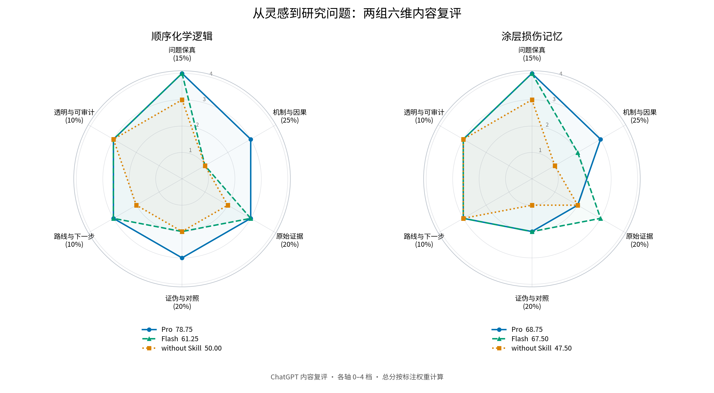

# ChatGPT 六维内容复评与雷达图

第一题突出 Pro 的机制辨析；第四题展示 Skill 如何帮助把灵感形成问题。

| 案例 | Pro | Flash | without |
|---|---:|---:|---:|
| 顺序逻辑 | 78.75 | 61.25 | 50.00 |
| 损伤记忆 | 68.75 | 67.50 | 47.50 |



- [顺序逻辑单图](sequential-logic-radar.png) · [损伤记忆单图](damage-memory-radar.png)
- [量表](RUBRIC.md) · [评分数据与源文件哈希](scores.json)
- [顺序分项](sequential-logic-scores.md) · [损伤记忆分项](damage-memory-scores.md)

六轴为问题保真15%、机制与因果25%、原始证据20%、证伪与对照20%、路线与下一步10%、透明与可审计10%。图轴均为0–4档，图例列加权总分；时间、token和交互记录另表呈现。

评分由 ChatGPT 于2026-10-27直接复评现有输出。每条件一次运行，执行模型统一K2.8 Preview + max；评阅为事后非盲内容评价。Kimi原分数与工作流评分留在上级目录的历史表中，主展示不再混用派生综合分。

```bash
python -m pip install matplotlib numpy
python examples/pro-flash-evaluation/independent-review/render_radars.py
```

可加 `--font /path/to/CJK-font.otf` 指定中文字体，或 `--out /path/to/exports` 单独导出。没有中文字体时使用英文轴名。脚本先检查分项、总分、量表与源文件哈希，再生成两张单图、一张总览以及分项表（PNG/SVG/CSV/Markdown）。

从参赛包中的独立评分目录重绘时，可加 `--scores-only`：仍检查分项、总分和量表哈希，但跳过公开仓库报告路径检查。源报告哈希继续保留在JSON中，用于回到完整实例核对。
